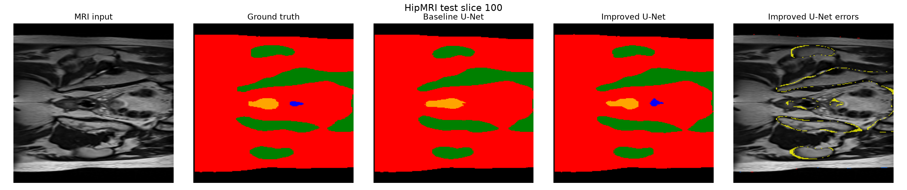
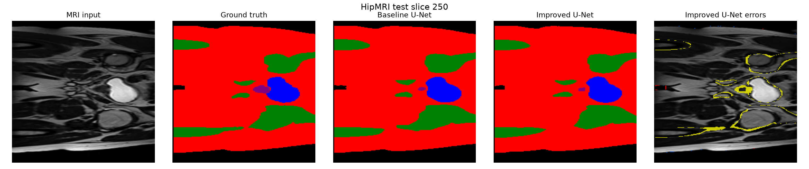
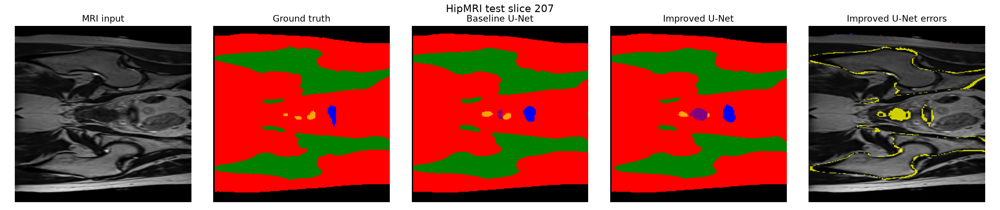
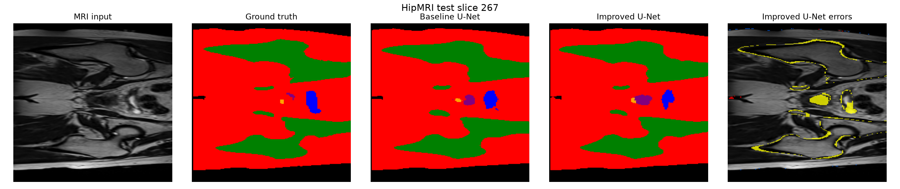
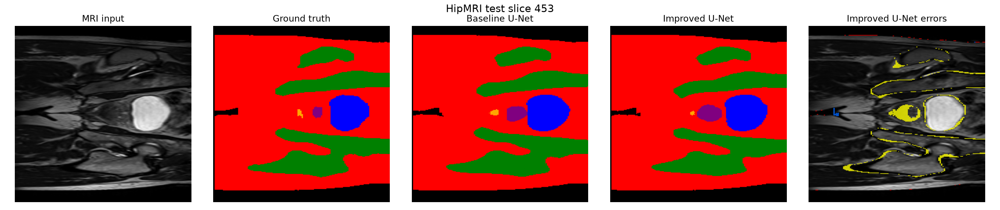
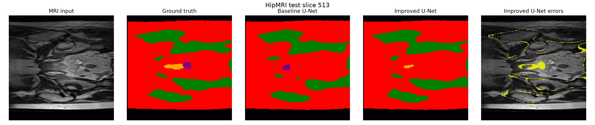

Student number: 48143084
Name: Tony Li

## Project Overview

The aim of this project was to develop an Improved U-Net to segment anatomical regions in prostate MRI scans and investigate whether it performs better than a standard U-Net while remaining computationally efficient. Two models were implemented using PyTorch, consisting of a base U-Net and an Improved U-Net that incorporates residual convolutional blocks. Both models were trained using the same dataset splits and preprocessing methods to ensure a fair comparison. Their performance was evaluated using

- Dice score
- Intersection over Union (IoU)
- Inference time
- GPU memory usage

The project also examines segmentation failures to identify the limitations of the models and explore potential areas for improvement.

## Algorithm and Architecture

The underlying U-Net employs an encoder-decoder architecture to extract features from MRI images and build segmentation masks. The encoder uses convolutional layers to identify significant information, and the decoder restores image resolution. Skip connections help to preserve spatial features during the process.

The Improved U-Net builds on the same architecture, but adds residual convolutional blocks to improve feature learning and gradient flow. Both algorithms process single-channel MRI images, assigning each pixel to one of six segmentation groups.

As illustrated in the figure below we see both models generate segmentation masks that closely approach the ground truth. However we can see that it’s not perfect as inequalities exist at boundaries and in smaller regions. The error overlay shows the places where the Improved U-Net makes incorrect predictions.



## Feasibility Review

### User Need, Scope and Acceptance Criteria

The project's goal is to create a 2D deep learning model that can separate prostate MRI pictures into different sections. The purpose of this is that using these accurate segmentations we can help medical image analysis by making it easier to add notes by hand.

**Acceptance criteria:**

1. Segmentation Accuracy: Achieve a Dice score greater or equal to 0.75

2. Model Improvement: Compare the Improved U-Net against a standard U-Net baseline using Dice and IoU scores to find more accurate segmentations.

3. Fair Evaluation: Train and evaluate both models using the same training, validation and testing splits.

4. Computational Efficiency: Measure and compare GPU memory usage and inference time to determine whether the Improved U-Net is computationally practical.

5. Failure Analysis: Analyse around 5 examples to identify boundary errors and limitations of the improved model.

### Model Choice and Course Concepts

A standard U-Net baseline will be put up against a 2D Improved U-Net. U-Net is good for medical image segmentation because it has an encoder–decoder structure and skip connections that keep spatial information. For the upgraded U-Net, residual convolutional blocks will be added to improve feature learning and gradient flow.

Both models will use PyTorch and identical preprocessing and evaluation methods. The HipMRI dataset provides MRI slices with corresponding segmentation masks. Course concepts such as CNNs and skip connections support feature extraction and spatial information preservation. Dice measures overlap relative to the total size of both regions, while IoU measures overlap relative to the combined area covered by either region.

### Preliminary Feasibility Evidence

| Dataset | MRI slice | Segmentation |
| --- | --- | --- |
| Training | 11460 | 11460 |
| Validation | 660 | 660 |
| Testing | 540 | 540 |

Images and masks have matching dimensions of 256 × 128 pixels.

### Risks, Computing Budget and Fallback

The main risks include overfitting, incorrect segmentation boundaries and GPU memory limitations.

Both models will be trained using Rangpur GPU resources, with training time, memory usage and inference speed monitored. If the Improved U-Net does not outperform the baseline, the results will be analysed to determine whether the additional complexity is justified.

## Implementation and Reproducibility

The project was developed using Python 3.11.15 and PyTorch 2.14.0+cu130 on UQ's Rangpur GPU cluster with CUDA 13.0. Some additional dependencies include NumPy or Matplotlib.

The HipMRI dataset is available at /home/groups/comp3710/HipMRI_Study_open/keras_slices_data. Both models use identical preprocessing, training and evaluation splits. A fixed random seed of 42 was used to support reproducibility.

**Training the baseline U-Net:**

```bash
python train.py --model baseline --loss ce --epochs 10 --batch-size 4 --lr 0.0001 --seed 42 --run-name baseline_v1
```

**Training the Improved U-Net:**

```bash
python train.py --model improved --loss ce --epochs 10 --batch-size 4 --lr 0.0001 --seed 42 --run-name improved_v1
```

**Evaluating both models:**

```bash
python evaluate.py --batch-size 4
```

**Generating segmentation visualisations:**

```bash
python predict.py --indices 100 250 --output-dir evaluation/figures
```

## Dataset and Preprocessing

The HipMRI dataset consists of 12,660 MRI slices with corresponding segmentation masks. The original training was maintained to ensure a consistent evaluation. A patient-level check confirmed that there was no overlap between the 31 training patients, four validation patients or the three testing patients. Before training we made sure the MRI slices were normalised to a range of [0, 1] and resized from 256 × 128 to 256 × 256 pixels.

## Progressive Experiments

| Experiment | configuration | Best validation Dice |
| --- | --- | --- |
| 1 | Baseline U-Net | 0.9133 |
| 2 | Improved U-net | 0.9239 |
| 3 | Improved U-net and dice | 0.9198 |
| 4 | Improved U-net with 0.00005 LR | 0.9230 |
| 5 | Improved U-Net with 0.0001 weight decay | 0.9222 |

The baseline U-Net was used as a starting point to compare the results. After adding residual blocks, the validation Dice score improved from 0.9133 to 0.9239. Further experiments were carried out using different loss functions, learning rates and regularisation settings to see if the model could perform better. However, none of these changes achieved a higher score than the original Improved U-Net. Therefore, the Improved U-Net with cross-entropy loss and a learning rate of 0.0001 was chosen for final testing. These experiments helped identify which settings worked best and showed how the model was gradually improved throughout the project.

Experiments 4 and 5 tested whether smaller adjustments could improve the model. The learning rate was halved to 0.00005 to allow smaller parameter updates, while weight decay of 0.0001 was tested to reduce overfitting. Neither setting improved on the original Improved U-Net configuration.

## Results and Benchmarking

| Metric | Baseline U-Net | Improved U-Net |
| --- | --- | --- |
| Mean Dice | 0.9241 | 0.9323 |
| Mean IoU | 0.8657 | 0.8786 |
| Parameters | 31,030,918 | 32,438,342 |
| Peak allocated GPU memory (MiB) | 242.16 | 366.84 |
| Inference time per image (ms) | 3.42 | 2.84 |

Both models were tested on the same 540 unseen MRI slices to make sure the comparison was fair. This table essentially tells us that adding residual blocks helped the model produce segmentations that matched the ground truth more closely.

However, this improvement came with some trade-offs. The Improved U-Net used 4.54% more parameters and approximately 51.5% more GPU memory. Although its measured inference time was slightly faster at 2.84 ms compared to 3.42 ms, but more repeated tests would be needed to confirm whether it is consistently faster. Overall, the Improved U-Net improved segmentation accuracy but required more memory to achieve these results.

The GPU memory values are peak PyTorch memory allocated during model inference, rather than total GPU memory usage.

### Class-Level Dice

| class | Baseline | Improved |
| --- | --- | --- |
| 0 | 0.9965 | 0.9971 |
| 1 | 0.9833 | 0.9853 |
| 2 | 0.9312 | 0.9390 |
| 3 | 0.9615 | 0.9626 |
| 4 | 0.8344 | 0.8627 |
| 5 | 0.8379 | 0.8472 |

Looking at the results for each class, the Improved U-Net achieved higher Dice scores across all six classes. Classes 0 and 1 had the highest scores for both models, while classes 4 and 5 were the most difficult to segment accurately. The larger improvement in class 4, from 0.8344 to 0.8627, suggests that the residual blocks were particularly helpful for this region.



Looking at the figure above we see how it provides a visual example of these results using test slice 250. Both models produced segmentation masks that were similar to the ground truth, especially for the larger regions. There were still some differences around the boundaries and smaller areas as the error overlay highlights where the Improved U-Net predicted the wrong class, showing that even though its overall Dice score was high there was still segmentation error.

## Failure-Case Analysis

| slice | Baseline errors | Improved errors |
| --- | --- | --- |
| 207 | 1990 | 2041 |
| 267 | 2015 | 2196 |
| 453 | 2001 | 2215 |
| 513 | 3305 | 1882 |

To identify difficult segmentation cases, failcs.py was used to calculate the mean foreground Dice score for each test slice and rank the results. The predict.py script was then used to compare the baseline and Improved U-Net predictions visually.

Slice 207: The model had a hard time telling the difference between nearby small structures. The predicted region was bigger than the actual region, which could mean that it was hard to learn the small class limits.



Slice 267: This was a difficult foreground segmentation case. The Improved U-Net overpredicted a small region and missed parts of another structure.



Slice 453: The larger structures were segmented pretty well, but the smaller areas had problems with the edges.



Slice 513: The Improved U-Net made 1,423 fewer pixel errors than the baseline, although some parts of smaller structures were still missed.



From these examples we can see that most of the errors happened when the model confused different anatomical regions rather than mistaking them for the background. So in the future to improve this, future experiments could focus more on smaller regions and boundaries to help the model make more accurate predictions.

## Discussion and Conclusion

In conclusion we see that by adding residual blocks to the U-Net it improves segmentation accuracy overall. The baseline and Improved U-Net had different Dice scores:

- Baseline Dice: **0.9241**
- Improved U-Net Dice: **0.9323**

This demonstrates that the adjustments made to the original structure were beneficial, particularly for locating tiny portions of the body.

However, several aspects of the improvement were less than ideal. The Better U-Net required around 51.5% more GPU memory and did not perform better across all test slices. When it came to failure instances, both models struggled with smaller areas and dividing lines between groups. This demonstrates that having a high overall Dice score does not always imply that all of the image's components are accurately segmented.

Based on these findings, the Improved U-Net would be more suitable for tasks where segmentation accuracy is important and sufficient GPU memory is available. And since the improvement in accuracy was relatively small, the baseline U-Net may be a more practical option when computational resources are limited. Before either model could be used in clinical practice, further testing on a larger and more diverse patient dataset would be needed to evaluate how well the models perform across different MRI scans and patients.

The project's major purpose was to develop a baseline U-Net and an improved U-Net and then compare them in the same conditions. The Improved U-Net performed better overall however the testing revealed that increasing accuracy requires more computer power, and that there is still much work needed to improve it before it is good for practical use.

## References

1. Ronneberger, O., Fischer, P., & Brox, T. (2015). U-Net: Convolutional networks for biomedical image segmentation. In Medical Image Computing and Computer-Assisted Intervention – MICCAI 2015 (pp. 234–241). Springer. [https://link.springer.com/chapter/10.1007/978-3-319-24574-4_28]

2. He, K., Zhang, X., Ren, S., & Sun, J. (2016). Deep residual learning for image recognition. In Proceedings of the IEEE Conference on Computer Vision and Pattern Recognition (CVPR) (pp. 770–778). [https://ieeexplore.ieee.org/document/7780459]

3. Milletari, F., Navab, N., & Ahmadi, S. A. (2016). V-Net: Fully convolutional neural networks for volumetric medical image segmentation. arXiv. [https://arxiv.org/pdf/1606.04797]

## Artificial Intelligence Usage Disclosure

ChatGPT was used to help plan, build, debug and document this project. It assisted with reviewing PyTorch code, suggesting improvements to data loading and model implementation, fixing issues in training and evaluation scripts, organising experimental results and visualisations, and improving the readability of code and the flow of the README.

AI-assisted code was reviewed and tested to check that it worked as intended. This included checking dataset loading, model outputs and evaluation results. Five experiments were conducted and documented to compare the models and test different settings. Segmentation images and failure-case analysis were also used to identify errors and areas for improvement.

